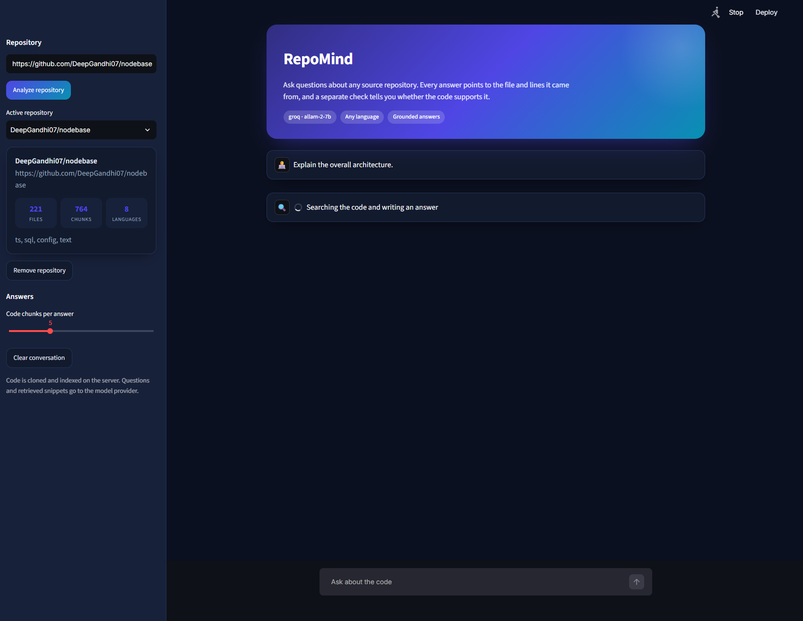
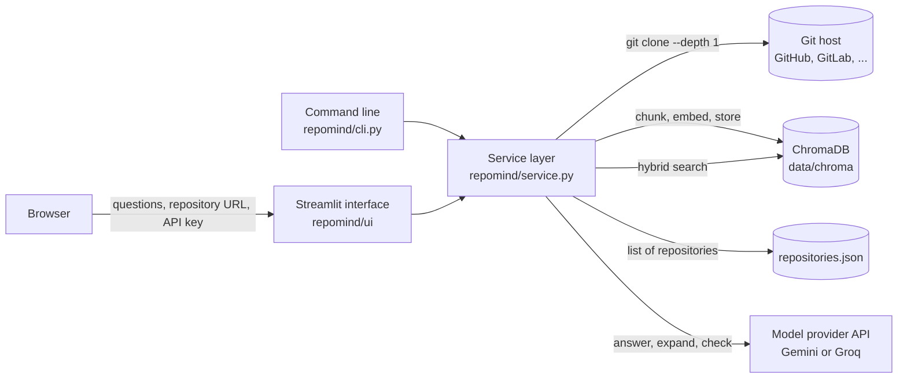

# RepoMind

**Ask questions about any code repository and get answers that point to the exact files and lines.**

RepoMind reads a repository, finds the code relevant to your question, and has a language model answer using only that code. Every claim is cited, and a second check shows whether the code supports the answer.



## The problem

Learning a new codebase is slow. You search for names, open files one by one, and guess how they connect. A normal chatbot has never seen your repository, so it either guesses or invents details.

RepoMind reads the repository first, so every answer is based on real code, and you can check each citation yourself.

## Features

- **Ask in plain language**, such as "Where is authentication handled?" or "What does this project do?"
- **Citations on every answer**, in the form `file.py:10-25`, with the matching code shown below the answer
- **Grounding badge** that says whether the code supports the answer
- **Any language and any git host**: GitHub, GitLab, Bitbucket, or your own server. Private repositories work with an access token
- **Bring your own API key** for Google Gemini or Groq, entered in the sidebar and kept in your browser session only
- **Several repositories** at once, with a switcher
- **Command line** for scripts and local folders

## Architecture

RepoMind has four parts: a web interface, a service layer that does the work, a local database, and an external model provider.



| Part | Where it lives | Responsibility |
|---|---|---|
| Interface | `repomind/ui/`, `streamlit_app.py` | Sidebar for connecting a key and analyzing repositories, plus the chat view |
| Service layer | `repomind/service.py` | The single entry point for analyze, ask, list, and remove, used by both the interface and the CLI |
| Ingestion | `repomind/ingest.py`, `repomind/languages.py` | Clones or reads a repository and filters its files |
| Indexing and search | `repomind/code_processor.py`, `repomind/vector_store.py` | Chunking, embeddings, ChromaDB synchronization, hybrid search |
| Answering | `repomind/answer_generator.py`, `repomind/citation_validator.py`, `repomind/grounding_checker.py` | Retrieval modes, prompting, citation checks, grounding |
| Model access | `repomind/llm.py` | Providers, per-request keys, retries, quota handling |
| Storage | `data/chroma/`, `data/repositories.json` | Vectors and the list of analyzed repositories |

**Per-user keys.** A key you enter is attached to each request and used for that request only. It is not written to disk, placed in the registry, or printed in logs, and error messages have it removed before they are shown.

**Storage.** Indexes and the repository list are stored under `data/` on the server. The query-expansion cache, described under [Privacy](#privacy-and-security), is also stored there.

## Technology stack

| Part | Tools |
|---|---|
| Language | Python 3.10+ |
| Web interface | Streamlit |
| Repository access | git |
| Framework | LangChain (text splitting, Chroma and embedding wrappers, `Document` objects) |
| Code search | ChromaDB (vectors), BM25 (keywords), local embeddings (sentence-transformers) |
| Language models | Google Gemini and Groq APIs |
| Testing and quality | pytest, ruff, GitHub Actions |

## Setup

You need **Python 3.10+**, **git**, and an **API key** from [Google AI Studio](https://aistudio.google.com/apikey) or [Groq](https://console.groq.com/keys). One key is enough.

```bash
git clone https://github.com/<your-username>/repomind.git
cd repomind

python -m venv .venv
source .venv/bin/activate          # Windows: .venv\Scripts\Activate.ps1

pip install -e ".[groq,dev]"       # leave out ",groq" if you only use Gemini
streamlit run streamlit_app.py
```

Open the address shown in the terminal (usually http://localhost:8501), then:

1. In the sidebar, choose a provider, paste your key, and click **Connect**.
2. Paste a repository URL and click **Analyze repository**.
3. Ask a question.

The first run downloads a small embedding model, which takes a moment.

### Command line

```bash
repomind analyze https://github.com/psf/requests
repomind ask "How are cookies stored across redirects?"
repomind models          # list models your key can use
repomind repos           # list analyzed repositories
```

For the command line, copy `.env.example` to `.env`, then set `LLM_PROVIDER` and your key.

## Configuration

Most people don't need to change anything. Settings such as keys, models, and limits are listed in [docs/CONFIGURATION.md](docs/CONFIGURATION.md).

## Privacy

- **What is sent to the model provider:** your question and the code chunks retrieved for it. Analysis runs on your machine or server, so repository contents are not uploaded for indexing.
- **Your key:** kept in your browser session on the server, and not written to disk or logs.
- **Secrets:** files such as `.env`, private keys, and credentials are skipped during analysis.
- **Public deployments:** set `REPOMIND_ALLOW_SERVER_KEY=false` so every visitor uses their own key, and put the app behind a login.

## Troubleshooting

- **Vague or repetitive answers:** the model is probably too small. Choose a larger model in the sidebar.
- **"Could not verify this key":** check that the key is complete and matches the selected provider.
- **"Model not available":** pick another model. Run `repomind models` to see what your key allows.
- **"Daily usage limit reached":** the provider's daily quota for this key is used up. Wait, or use another key.
- **Lots of `torchvision` messages:** harmless. They come from Streamlit's file watcher.

## Limitations

- Answers are only as good as the model. Small models give shallow answers.
- The grounding check is another model's judgment, so it can be wrong.
- Retrieval can miss the right file, especially for vague questions.
- Large repositories take a long time to analyze on a CPU.
- The web app has no login. Add authentication before sharing it.

## Contributing

Open an issue to discuss larger changes. Then fork the repository, make your change, add tests, and run `pytest -q` and `ruff check .` before opening a pull request. Never commit `.env` or API keys.

## License

This project is built for professional research workflows and educational applications. Feel free to use and modify.